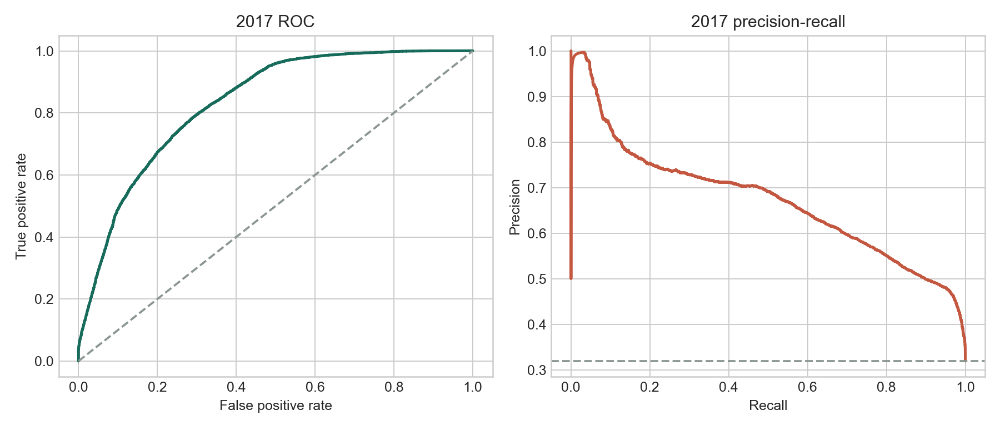
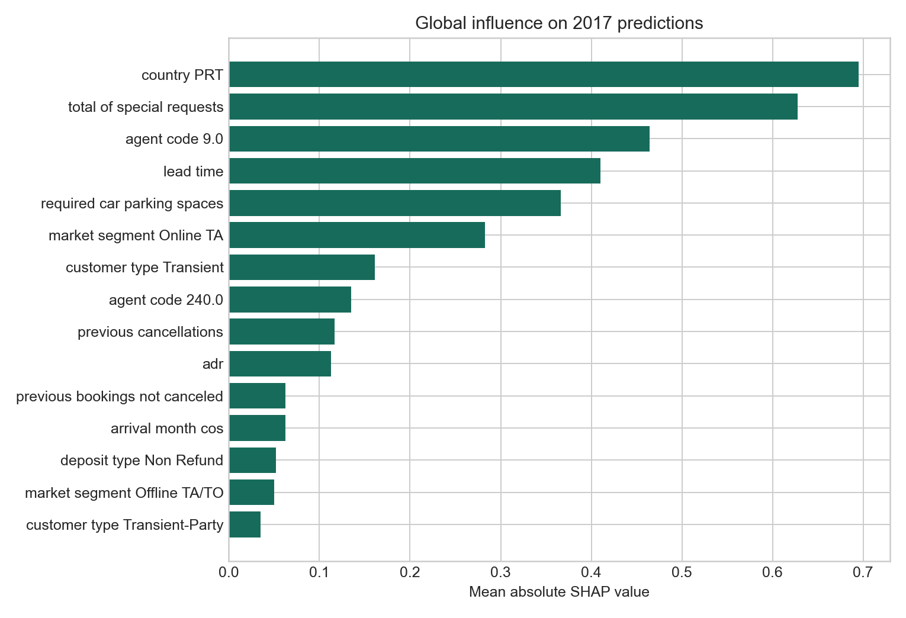
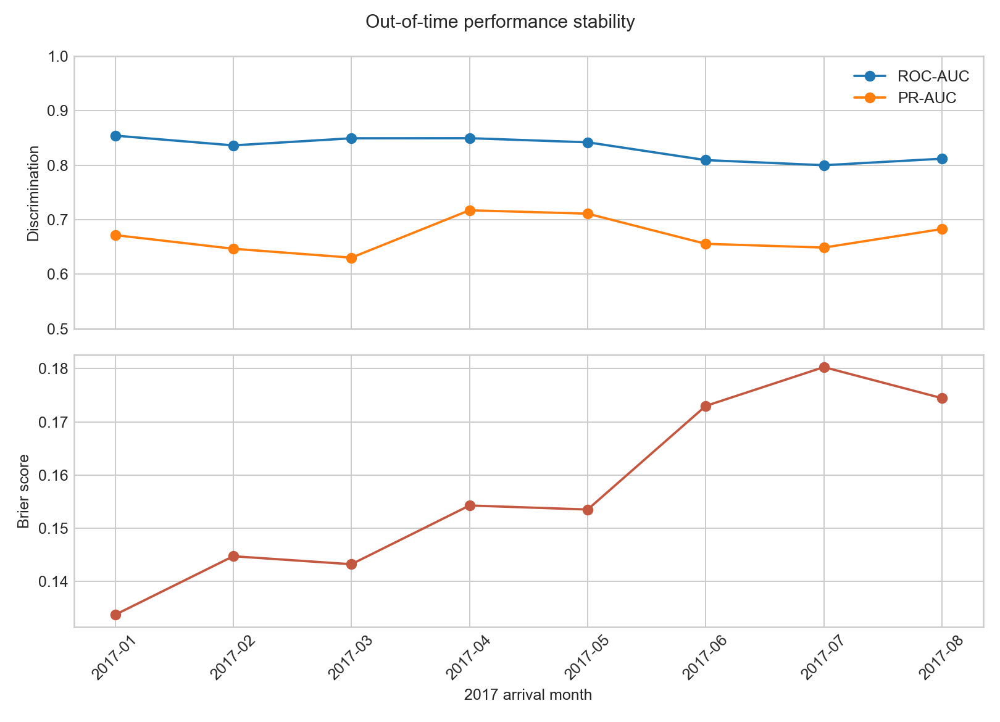
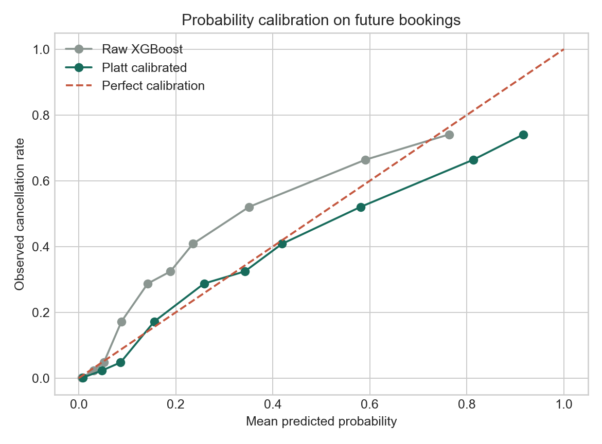
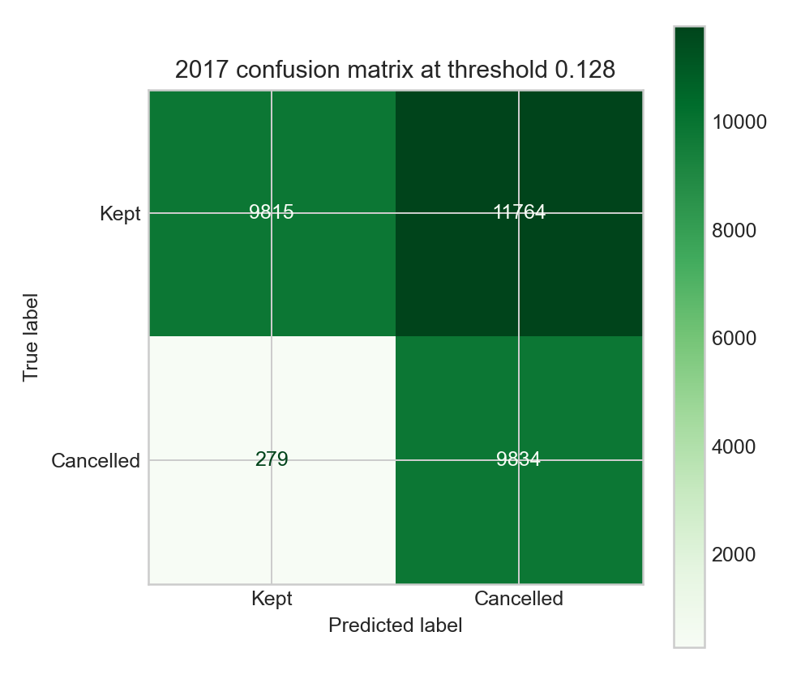

# Hotel Cancellation Risk ML

[](https://github.com/liyang6620/hotel-booking-cancellation-analytics/actions/workflows/ci.yml)
[](https://www.python.org/)
[](LICENSE)

An end-to-end machine learning system that estimates a hotel's cancellation risk at
**booking creation time**. The project prioritises leakage control, temporal validation,
calibrated probabilities, reproducible artifacts, and honest future-period evaluation.


## Results at a glance

| Evaluation | Result |
|---|---:|
| Untouched test window | 31,692 bookings, Jan-Aug 2017 |
| ROC-AUC | **0.832** (95% bootstrap CI 0.828-0.836) |
| PR-AUC | **0.672** (95% bootstrap CI 0.663-0.682) |
| Calibrated Brier score | **0.159** (raw model: 0.164) |
| Recall at the validation-selected threshold | **97.2%** |
| Selected model | Shallow XGBoost |

The operating point deliberately favours recall: a missed cancellation is assigned four
times the cost of an unnecessary intervention. At threshold `0.128`, the model catches
97.2% of cancellations but precision is 45.5%. This is a documented business trade-off,
not a claim that one threshold fits every hotel.

## Why this evaluation is credible

The original analysis reported about 0.95 AUC from a random split. That result was not a
reliable estimate of future performance: the data contains 31,994 exact duplicate rows,
and several fields are only known after booking creation. Version 2.0 rebuilds the
experiment around the real prediction point.

- Exact duplicate rows are removed before splitting because the dataset has no booking ID.
- Train, validation, and test data are separated chronologically.
- Model selection uses four expanding-window folds and PR-AUC as the primary metric.
- Imputation and one-hot encoding are fitted inside every fold through a scikit-learn pipeline.
- Validation data is used only for Platt calibration and threshold selection.
- The 2017 test period remains untouched until the final evaluation.
- `reservation_status`, `reservation_status_date`, and three post-booking fields are excluded.
- Confidence intervals quantify uncertainty instead of presenting a single score as exact.

```text
2015-07 to 2016-08       2016-09 to 2016-12       2017-01 to 2017-08
train + temporal CV  -> validation: calibrate  -> untouched final test
41,140 bookings         and choose threshold      31,692 bookings
                        14,564 bookings
```

## ML workflow

```text
raw booking data
  -> duplicate policy + prediction-time contract
  -> fold-local imputation and one-hot encoding
  -> temporal comparison: logistic regression / RF / XGBoost
  -> Platt probability calibration
  -> cost-aware threshold selection
  -> frozen model, preprocessor, calibrator, metadata, and regression fixture
```

The shallow XGBoost model achieved the best mean expanding-window PR-AUC:

| Candidate | Temporal PR-AUC | Temporal ROC-AUC | Brier score |
|---|---:|---:|---:|
| **XGBoost (shallow)** | **0.692 +/- 0.041** | **0.864 +/- 0.018** | **0.120** |
| Random forest | 0.658 +/- 0.060 | 0.839 +/- 0.030 | 0.130 |
| XGBoost (regularised) | 0.656 +/- 0.070 | 0.857 +/- 0.013 | 0.123 |
| Logistic regression | 0.567 +/- 0.067 | 0.820 +/- 0.032 | 0.161 |



## Explainability and drift

Native XGBoost SHAP contributions are computed on a fixed 5,000-row test sample. Country,
special requests, agent, lead time, parking requests, and market segment have the greatest
global influence. These are associations learned from historical data, not causal effects.

| Feature influence | Temporal stability |
|---|---|
|  |  |

Monthly ROC-AUC falls from 0.854 in January to about 0.800-0.812 in July and August, while
the Brier score rises. This is actionable drift evidence: a deployed version would require
monthly monitoring and a retraining trigger rather than silent long-term use.

## Probability quality and operating point

| Calibration | Validation-selected decision point |
|---|---|
|  |  |

Platt scaling reduces the untouched-test Brier score from 0.164 to 0.159. The threshold is
selected only on the validation period using `4 * false negatives + false positives`; it is
never tuned on the test set.

## Reproduce the project

Python 3.12 is the supported runtime.

```bash
python -m venv .venv
source .venv/bin/activate       # Windows: .venv\Scripts\activate
python -m pip install -r requirements-dev.txt
python scripts/train_model.py
python -m pytest
ruff check .
```

Training rebuilds the model bundle, evaluation tables, plots, split manifest, and score
regression fixture from `data/2022_hotel_bookings.csv`. On a typical laptop it takes a few
minutes because every candidate is refitted across four temporal folds.

The compact evidence notebook can also be executed independently:

```bash
python -m nbconvert --execute --to notebook --inplace hotel_booking_ml_evidence.ipynb
```

## Score bookings

The persisted preprocessor, model, and portable JSON calibrator are loaded separately so
training and inference share the same feature engineering contract.

```python
import pandas as pd

from hotel_cancellation.scoring import load_artifacts, score_bookings

bookings = pd.read_csv("data/2022_hotel_bookings.csv").head(5)
probabilities = score_bookings(bookings, load_artifacts())
print(probabilities)
```

Set `PYTHONPATH=src` when running the snippet without installing the package. The required
raw fields and excluded future fields are recorded in `artifacts/feature_contract.json`.

## Repository map

```text
artifacts/                     frozen model bundle, metadata, split and score fixtures
data/                          source hotel booking dataset
docs/MODEL_CARD.md             intended use, evaluation, risks, and monitoring plan
reports/figures/               generated ML evidence
reports/tables/                machine-readable experiment results
scripts/train_model.py         one-command reproducible training entry point
src/hotel_cancellation/        features, training, calibration, and scoring code
tests/                         contracts, leakage, split, artifact, and inference tests
hotel_booking_ml_evidence.ipynb compact executable evidence notebook
```

## Scope and limitations

- The public dataset covers two Portuguese hotels from 2015-2017; it is not representative
  of every property, market, or current customer population.
- Temporal evaluation uses planned arrival date, the reliable event timestamp in the source.
  It measures generalisation to future stay cohorts rather than a delayed-label online replay.
- Country and agent identifiers can encode location or commercial relationships and require
  governance review before operational use.
- SHAP values explain model behaviour, not why a guest cancels.
- The model is a portfolio-quality ML reference implementation, not a production reservation
  service. Live use would still need consent, access control, observability, rollback,
  service-level objectives, and continuous drift/fairness review.

See the [model card](docs/MODEL_CARD.md) for the full evaluation and responsible-use notes.

## Data and licence

The project uses the Hotel Booking Demand dataset described by Antonio, Almeida, and Nunes
in [Data in Brief (2019)](https://doi.org/10.1016/j.dib.2018.11.126). Code is released under
the [MIT License](LICENSE); dataset attribution and third-party terms are documented in
[NOTICE](NOTICE).

## Author

**Yang Li**
